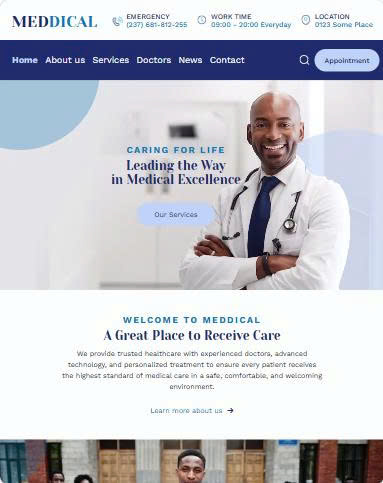
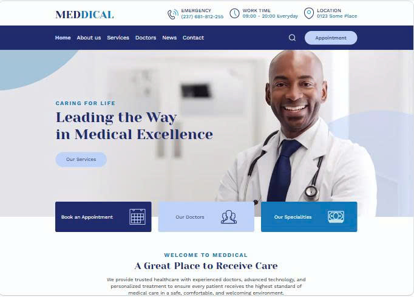

# MEDDICAL - Website Bệnh viện - Nhom11

## 1. Giới thiệu đề tài

**Tên đề tài:**  MEDDICAL — Hospital / Medical Website

MEDDICAL là website giới thiệu và hỗ trợ các dịch vụ của bệnh viện, được xây dựng dựa trên thiết kế Figma Community. Website cung cấp các thông tin về bệnh viện, dịch vụ, chuyên khoa, đội ngũ bác sĩ và tin tức sức khỏe, đồng thời hỗ trợ người dùng tìm kiếm bác sĩ và đặt lịch khám trực tuyến.

Website được phát triển theo hướng responsive, đảm bảo giao diện có thể thích ứng trên các kích thước màn hình Mobile, Tablet và Desktop.

**Link Figma:**  
(https://www.figma.com/design/kgyxBxhVALINPXxeOTfzcl/MEDDICAL---nh%C3%B3m-11?node-id=147-1780&p=f&t=YmV26YiNEpiveU1y-0)

**Link sản phẩm đã deploy:**  
(https://meddical-nhom11.vercel.app/)

## 2. Các chức năng chính

- Hiển thị danh sách bác sĩ và thông tin chi tiết của từng bác sĩ.
- Tìm kiếm bác sĩ theo tên và lọc theo chuyên khoa.
- Đặt lịch khám theo bác sĩ, chuyên khoa, ngày và khung giờ.
- Kiểm tra dữ liệu biểu mẫu và hiển thị thông báo lỗi trực tiếp tại từng trường.
- Kiểm tra ngày, giờ và lịch hẹn trùng khi đặt lịch khám.
- Lưu lịch hẹn bằng LocalStorage, hỗ trợ xem và hủy lịch tại trang Lịch hẹn của tôi.
- Hiển thị tin tức sức khỏe và hỗ trợ lấy dữ liệu từ NewsAPI.
- Tìm kiếm, lọc theo danh mục và phân trang danh sách tin tức.
- Xem thông tin chi tiết của bài viết.
- Hiển thị FAQ theo dạng Accordion.
- Hiển thị phản hồi người dùng bằng Carousel.
- Hiển thị bản đồ và giờ làm việc tại trang Liên hệ.
- Kiểm tra dữ liệu Form liên hệ và đăng ký nhận bản tin.
- Responsive trên Mobile, Tablet và Desktop.

## 3. Công nghệ sử dụng

- **HTML5:** Xây dựng cấu trúc và nội dung các trang.
- **Tailwind CSS v4:** Thiết kế giao diện và xây dựng Responsive.
- **JavaScript ES6+:** Xử lý các chức năng và tương tác trên website.
- **Vite:** Công cụ phát triển và build dự án.
- **NewsAPI:** Cung cấp dữ liệu tin tức sức khỏe.
- **LocalStorage:** Lưu trữ và quản lý lịch hẹn trên trình duyệt.
- **Git & GitHub:** Quản lý mã nguồn và hỗ trợ làm việc nhóm.
- **Vercel:** Triển khai website.

## 4. Danh sách thành viên và phân công

| STT | Thành viên | MSSV | Trang phụ trách | Chức năng JavaScript phụ trách |
|:---:|---|:---:|---|---|
| 1 | **Nguyễn Gia Hân** | 2354050034 | Doctors<br>Doctor Detail<br>News<br>News Detail | • Tìm kiếm bác sĩ theo tên và lọc theo chuyên khoa.<br>• Lọc, tìm kiếm và phân trang tin tức.<br>• Lấy dữ liệu News Card từ NewsAPI. |
| 2 | **Nguyễn Minh Phúc** | 2354050100 | Home<br>Services<br>Service Detail<br>Contact<br>My Appointment<br>Specialty Detail | • Hiển thị lịch hẹn tại trang **Lịch hẹn của tôi**.<br>• Hủy lịch hẹn.<br>• FAQ Accordion. |
| 3 | **Nguyễn Ngọc Quý** | 2354050104 | About<br>Appointment | • Đặt lịch khám theo bác sĩ, chuyên khoa, ngày và giờ.<br>• Kiểm tra ngày, giờ và lịch hẹn hợp lệ.<br>• Kiểm tra hợp lệ dữ liệu biểu mẫu và hiển thị lỗi inline.<br>• Lưu lịch hẹn vào LocalStorage. |

## 5. Cách cài đặt

Để cài đặt dự án MEDDICAL trên máy, thực hiện các bước sau:

### Bước 1: Đảm bảo đã cài đặt Node.js

Dự án yêu cầu **Node.js** để cài đặt các thư viện và chạy môi trường phát triển.

Nếu máy chưa có Node.js, tải và cài đặt phiên bản **LTS** tại trang chủ Node.js.

Sau khi cài đặt, có thể kiểm tra bằng các lệnh:

```bash
node -v
npm -v
```

Nếu cả hai lệnh đều hiển thị số phiên bản thì Node.js và npm đã được cài đặt thành công.

### Bước 2: Clone repository

Mở **Terminal**, **PowerShell** hoặc **Git Bash** và chạy:

```bash
git clone https://github.com/hanghanghangw/MEDDICAL-Nhom11.git
```

### Bước 3: Di chuyển vào thư mục dự án

```bash
cd MEDDICAL-Nhom11
```

### Bước 4: Cài đặt các thư viện cần thiết

```bash
npm install
```

Lệnh trên sẽ cài đặt các thư viện và dependencies cần thiết của dự án.

Sau khi quá trình cài đặt hoàn tất, dự án đã sẵn sàng để chạy trên môi trường local.

## 6. Cách chạy dự án

Sau khi hoàn tất quá trình cài đặt, thực hiện các bước sau để chạy dự án MEDDICAL trên máy.

### Bước 1: Khởi động môi trường phát triển

Tại thư mục dự án, chạy lệnh:

```bash
npm run dev
```

### Bước 2: Mở website

Sau khi chạy thành công, Terminal sẽ hiển thị địa chỉ Local của website, ví dụ:

```text
http://localhost:5173/
```

Giữ Terminal đang chạy và mở địa chỉ được hiển thị bằng trình duyệt để truy cập website.

### Bước 3: Dừng dự án

Khi muốn dừng môi trường phát triển, quay lại Terminal và nhấn:

```text
Ctrl + C
```
## 7. Responsive

Website MEDDICAL được xây dựng theo hướng responsive, giao diện có khả năng thích ứng với nhiều kích thước màn hình khác nhau. Nhóm đã kiểm thử giao diện trên các kích thước Mobile S, Mobile M, Mobile L, Tablet và Laptop/Desktop.

Dưới đây là giao diện trang Home tại ba breakpoint đại diện:

### Mobile - 375px


### Tablet - 768px



### Laptop - 1366px



## 8. Triển khai

Website MEDDICAL được triển khai trên nền tảng **Vercel**, giúp người dùng có thể truy cập và trải nghiệm website trực tuyến mà không cần cài đặt dự án trên máy.

**Link website:**  
https://meddical-nhom11.vercel.app/

### Cách triển khai

1. Đưa mã nguồn của dự án lên GitHub.
2. Kết nối repository GitHub với Vercel.
3. Cấu hình và thực hiện deploy dự án.
4. Sau khi deploy thành công, Vercel cung cấp đường dẫn để truy cập website trực tuyến.

Khi mã nguồn trên repository được cập nhật, website có thể được triển khai lại để đồng bộ với phiên bản mới nhất.